# North Carolina flood mapper (NASA HLS)

**Goal:** map the flood water that Hurricane Florence (September 2018) left around Lumberton, North Carolina, using NASA's Harmonized Landsat Sentinel-2 (HLS) satellite images, and measure honestly how good the maps are.

**Result:** a simple near-infrared rule finds about **half of the real flood (44%)**, and about **half of what it calls flood is real (48%)**, graded against 269 spots I labeled by hand on NOAA airplane photos. It beat a textbook water index, a radar map and two machine-learning models.

**Status:** Project 1, version 1 (floods) complete. Phase 2 (burn scars) is in progress: burn maps made and graded. The best one catches 73% of the official burn and is right 84% of the time.

## Summary
- The study area is a 23 x 17 km box around the Lumber River at Lumberton. It was the only one of three flooded river towns with a clear satellite photo soon after the storm (Sept 18, 2018, four days after landfall).
- **Flood = water on Sept 18 that was not water on Sept 6.**
- **The textbook method failed.** Standard water indexes (NDWI, MNDWI) found almost none of the flood, because the Lumber is a tea-colored blackwater river. Near-infrared light works for any water color.
- **Radar saw almost none of the flood either.** Most of this flood was shallow, with plants and trees sticking out, which looks rough, like land, to radar.
- **I built my own answer key:** 269 random spots, labeled blind on NOAA airplane photos taken one day after the satellite photo.
- **Machine learning did not beat the simple rule** when tested fairly, with whole areas hidden.
- Biggest blind spot: **water under and beside trees**, which no clue I used can see.

## Results
Graded on my hand-labeled spots. "Caught" is the share of the real flood a map found. "Right" is the share of its flood that really was water. Scores are weighted for how many pixels each spot stands for; ranges are 95% ranges from re-drawing the spots 2,000 times.

| Map | Caught | Right when it says flood | Overall accuracy |
|---|---|---|---|
| Say dry everywhere (baseline) | 0% | - | 96% |
| Textbook water index (MNDWI > 0) | - | - | finds 1.0 km² of flood; not graded |
| **Dark in near-infrared (NIR < 0.10)** | **44%** (26-82%) | **48%** (38-59%) | 96% |
| Near-infrared fell by half | 56% (33-100%) | 42% (33-50%) | 95% |
| Radar (Sentinel-1, one band, one cutoff) | 1% (0-4%) | too few spots | 96% |
| Logistic regression (graded by area) | 25% | 50% | 96% |
| Random forest (graded by area) | 23% | 59% | 96% |

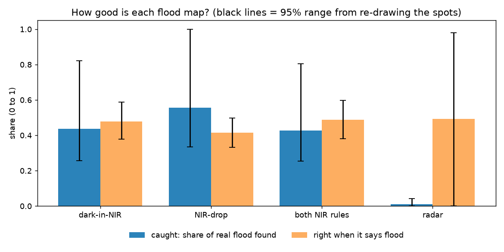

**Overall accuracy is useless here.** Almost the whole box is dry, so a map with no flood at all also scores 96%. That is why I report "caught" and "right" instead.

Estimated real flood in the cloud-free part of the box: **about 12 km²**. This estimate is uncertain (see Limits).

## How it works

### 1. Finding clear photos
Clouds are the main problem around a hurricane. For three flooded river towns I read the HLS cloud mask (Fmask) for every photo from Aug 15 to Oct 10, 2018, and measured how much of each box was clear.


| River box | Clear on Sept 18 | Next photo at least 80% clear |
|---|---|---|
| **Lumber (Lumberton)** | **86%** | Sept 18 |
| Cape Fear (Fayetteville) | 79% | Oct 1 |
| Neuse (Kinston) | 63% | Oct 3 |

Only the Lumber box had a clear photo soon after the storm, plus clear "before" photos, so it became the study area.

### 2. Water maps and flood maps
Before: Sept 6. After: Sept 18. Both photos are Sentinel-2, so any change comes from the ground, not from a camera change.

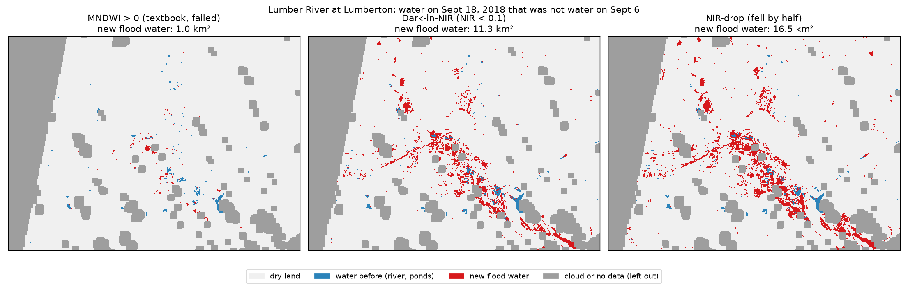

- **Textbook indexes failed.** NDWI and MNDWI compare green light with infrared. Tea-colored blackwater is darker in green than in shortwave infrared, so the formulas call it land: they found 0.2 and 1.0 km².
- **Near-infrared works for any water color.** In flooded pixels, near-infrared fell from 0.27 to 0.04. Two rules: "dark in near-infrared" (NIR < 0.10) found 11.3 km²; "near-infrared fell by half" found 16.5 km².
- **The cutoff matters.** The histograms have no clean gap between water and land, so the area moves from 5 to 21 km² as the cutoff goes from 0.05 to 0.15. I picked 0.10 from the histogram, before looking at any labels.

### 3. A radar flood map
Radar sends its own microwave pulse, so clouds don't block it. Calm open water reflects the pulse away and looks dark. I used Sentinel-1 radar from Sept 7 and Sept 19, processed by NASA's free HyP3 service.


Radar found only 0.9 km² of new open water. It agreed with the near-infrared maps on just 2-3% of the flagged area. The airplane photos explain why: where only near-infrared said flood, it was mostly shallow water with plants or trees sticking out, which radar sees as rough ground. Where radar got brighter, the photos show plowed fields, not hidden water.

### 4. The answer key
I labeled 269 random spots by eye on NOAA airplane photos from Sept 19-20, 2018, one day after the satellite photo: water, not water, or can't tell.
- Spots were picked from four groups (each map's flood, plus spots every map called dry), so every map was tested. This is a **stratified sample**; the scores are corrected for group sizes.
- The labeling page was **blind**: it never showed which map picked a spot, and the order was shuffled.


### 5. Machine learning
Two models learned "water or not water" from my labels, using 21 clues per pixel: color bands before and after, water indexes, near-infrared change and radar. Logistic regression draws one straight dividing line; a random forest is 300 small decision trees that vote.

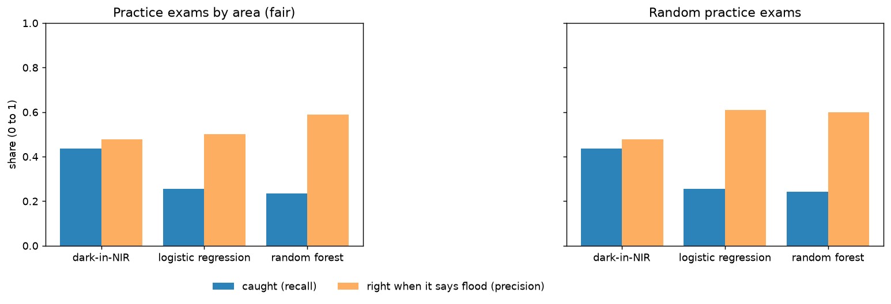

The models were pickier than the rule: right more often when they said flood (59% for the forest), but they missed about half of what the rule caught. On balance (F1 score) the rule wins, 0.46 to 0.34. The forest leaned on the same near-infrared clues as the rule; radar barely helped.

## How I kept the testing honest
- **An independent answer key.** The labels come from airplane photos, a different camera from the satellite that made the maps.
- **Blind labeling.** The labeling page never showed which map picked a spot.
- **Checking the labeler.** I re-labeled 40 random spots a second time without seeing my first answers: same answer 65% of the time, 90% when neither pass said "can't tell". Using the second-look answers instead moves the grades by only 1-2 points.
- **Cutoffs chosen before grading.** The near-infrared cutoff was picked from a histogram, never by looking at the labels.
- **Practice exams by area, not by spot.** For machine learning, I cut the box into 16 blocks and hid whole blocks. Neighboring spots look almost the same, so hiding single spots lets a model peek. With shuffled spots, logistic regression looked better than it was (61% right instead of 50%). It is the same lesson as splitting by engine, not by row, in Project 0.
- **A baseline that does nothing.** "Say dry everywhere" shows why overall accuracy can't be trusted here.

## What failed
- **Textbook water indexes.** NDWI and MNDWI missed almost all of the flood on a blackwater river.
- **Radar.** One band and one cutoff caught about 1% of the flood. Radar "brightening" turned out to be plowed fields, not water under trees.
- **Machine learning.** Neither model beat the simple rule when tested fairly.
- **My first cloud count.** It divided by the part of the box a tile covered, not the whole box, so a tile touching 2% of a box scored "97% clear". Fixed.
- **My first radar pair.** The scenes only touched the corner of the box (6% and 0% coverage), so every pixel was blank and two processing jobs were wasted. The code now checks real coverage first.
- **A drawing error.** The yellow square in my first photo check was drawn 24 m wide instead of 30 m. Fixed.
- **Rushed labels.** My first labeling pass took about 2 seconds a spot and leaned toward "not water" on unclear spots. The second look showed this barely changes the grades, but it is a limit.

## Limits of this work
- **One place, one day.** One 23 x 17 km box and one flood. The rule may not work elsewhere.
- **Clouds.** 22% of the box was cloudy on one of the two days and is left out of every optical map.
- **Wide uncertainty.** "Caught" for the best map could be anywhere from 26% to 82%. The real-flood estimate rests heavily on 2 "dry" spots I labeled water; each stands for about 3,000 pixels.
- **One day apart.** The airplane photos are one day after the satellite photo, and the radar is 1.5 days after. Some water may have drained in between.
- **Water under trees.** Optical satellites can't see it, and this simple radar rule didn't either.
- **One labeler.** All labels are mine; nobody else checked them.

## Phase 2: burn scars (in progress)
**Goal:** map a wildfire burn scar with the same code, and grade it against the official fire outline.

**The idea.** Living leaves reflect a lot of near-infrared light; burned ground reflects less of it and more shortwave infrared. The Normalized Burn Ratio (NBR) compares the two. A big drop in NBR from before to after means burned.

### Step 7: choosing the fire
Three candidates, each with an official outline: from NIFC (the fire agencies' shared outlines) or MTBS (a national archive of larger fires). Each downloaded outline matches the official size.

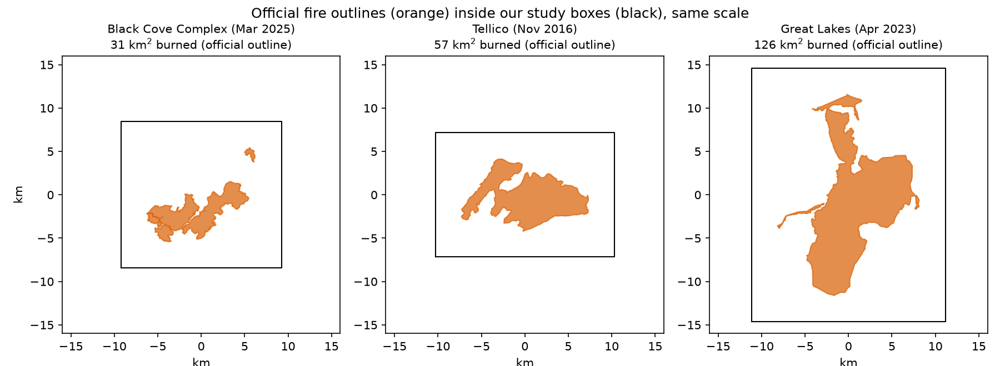

For each box (the outline plus a 3 km margin of unburned land) I counted clear photos from 60 days before the fire to 90 days after, with the same 80% rule as Step 1.

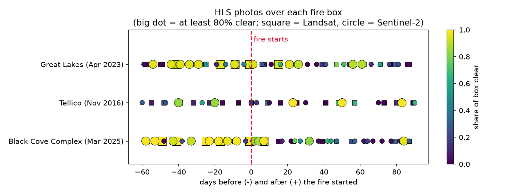

| Fire | Outline | Good photos before | Closest before | Good photos after | First good after |
|---|---|---|---|---|---|
| **Black Cove Complex** (Polk County, March 2025, 31 km²) | NIFC | 13 | 1 day | 6 | day 2 (still burning) |
| Tellico (November 2016, 57 km²) | MTBS | 2 | 20 days | 3 | day 23 |
| Great Lakes (Croatan forest, April 2023, 126 km²) | MTBS | 10 | 1 day | 6 | day 1 (still burning) |

**Chosen: Black Cove Complex.** It is a spring fire, so falling leaves cannot be mistaken for a burn, and it has a 100% clear photo one day before it started. Great Lakes is the backup.

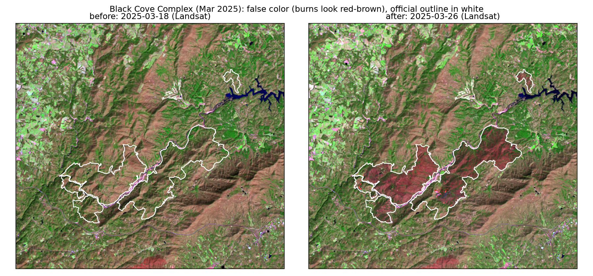

Shortwave infrared is shown as red, so burned ground looks red-brown. The scar fills the official outline (white).

Honest notes:
- **The early "after" photos are during the fire.** It grew until about March 31. On March 26 the lower-left lobe of the outline had not burned yet. After the fire stopped, the usable photos are April 12 (80% clear) and April 20 (83%).
- **There is an older burn in the box.** The red patch at the bottom edge is in both photos. A before-minus-after rule should ignore it.
- **Tellico has no good Landsat photo.** The edge of Landsat's flight path cuts through that box, so it often sees only 60-70% of it.
- **The Black Cove outlines are "auto-generated"** in the NIFC records, not "certified".

### Step 8: first burn maps
dNBR = NBR before minus NBR after. I made the map from two pairs of photos, each pair from one satellite:

| Pair | Before | After | Trade-off |
|---|---|---|---|
| April | Sentinel-2, March 11 | Sentinel-2, April 12 | Fire had stopped, but 22% cloud and trees leafing out |
| March 26 | Landsat, March 18 | Landsat, March 26 | 100% clear, but the fire was still growing |

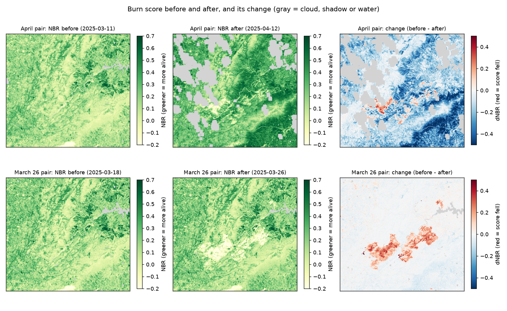

Each pair got two cutoffs, both fixed without looking at the official outline: the textbook one (dNBR > 0.10) and one read from the histogram (the triangle method: the foot of the big "nothing changed" pile).

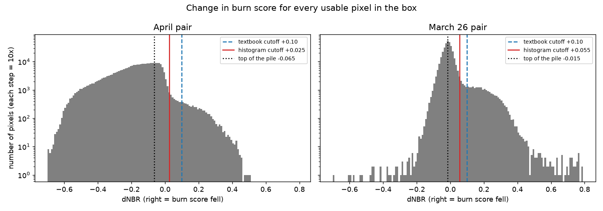

| Pair | Cutoff | Flagged as burned |
|---|---|---|
| April | textbook, +0.10 | 4.4 km² |
| April | histogram, +0.025 | 7.7 km² |
| March 26 | textbook, +0.10 | 19.8 km² |
| March 26 | histogram, +0.055 | 26.9 km² |

The official outline holds 31 km².

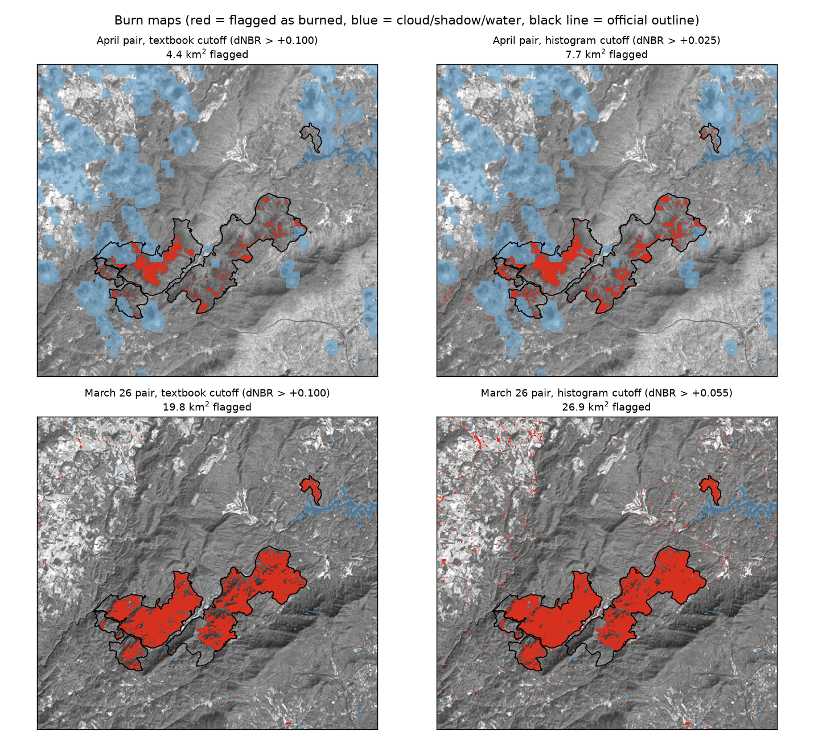

- **The textbook cutoff fails on the April pair.** In one month the whole landscape greened up (median NBR rose from 0.12 to 0.32), so "no change" is no longer at zero. The leaf season gets in the way, like blackwater did for the textbook water index.
- **A histogram cutoff helps a little, not enough.** Fields, pines and leafy forest each greened up by a different amount, so one cutoff for the whole box cannot separate the burn.
- **The March 26 pair is much cleaner,** but it misses the lower-left lobe (not burned yet), and the lower cutoff adds speckles on farmland.
- **The two maps overlap only 25%.** Almost everything April flags, March 26 flags too (6.2 of 7.7 km²).
- **The April burn is still visible to the eye:** pale and red inside a deep-blue forest. It stands out against its neighbors, which is the idea for the next step.
- The outline is drawn here for the eye only. The grades are in Step 9.

### Step 9: grading, and two fixes for the leaf season
Answer key: the official outline. "Caught" is the share of the outline a map flagged. "Right" is the share of its flags that fall inside the outline.

Two fixes for the April problem. Both ask whether a pixel's score fell 0.10 *more than normal*; they differ in what "normal" means. The rules were fixed before any score was computed.
- **Fix A, look-alikes:** normal = the typical change of pixels with a similar burn score before the fire, anywhere in the box (20 groups). It never uses the outline.
- **Fix B, ring:** normal = the typical change in a ring 300 m to 2 km outside the outline. This is what the national archive (MTBS) does, and it uses the answer key to build the map.

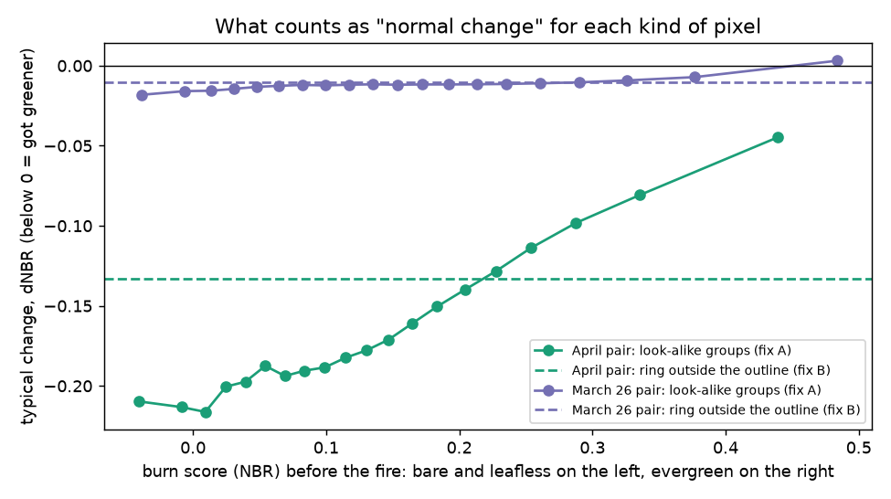

In April, leafless pixels greened up by about 0.2 and evergreens by only 0.05. In the March 26 pair nothing moved.

| Pair | Map | Caught | Right | F1 |
|---|---|---|---|---|
| April | textbook cutoff | 16% | 99% | 0.27 |
| April | histogram cutoff | 26% | 94% | 0.41 |
| April | fix A, look-alikes | 42% | 26% | 0.32 |
| April | fix B, ring | 37% | 32% | 0.34 |
| March 26 | textbook cutoff | 61% | 96% | 0.75 |
| **March 26** | **histogram cutoff** | **73%** | **84%** | **0.78** |
| March 26 | fix A, look-alikes | 65% | 94% | 0.77 |
| March 26 | fix B, ring | 64% | 94% | 0.76 |

Overall accuracy is useless again: only 10% of the box burned, so "say nothing burned" scores about 90%.

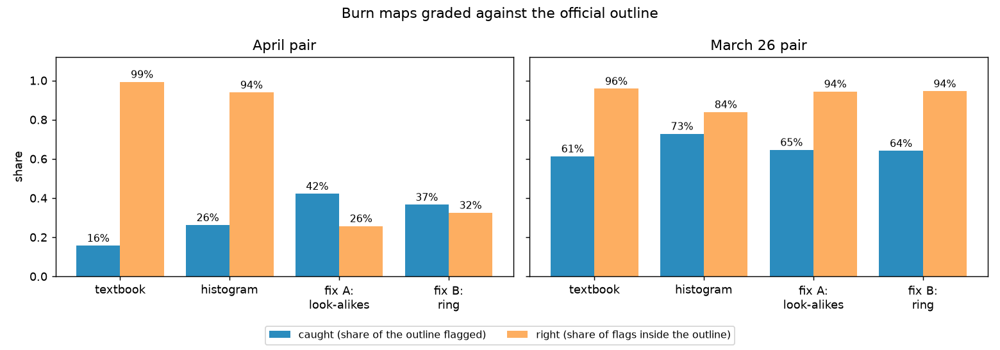

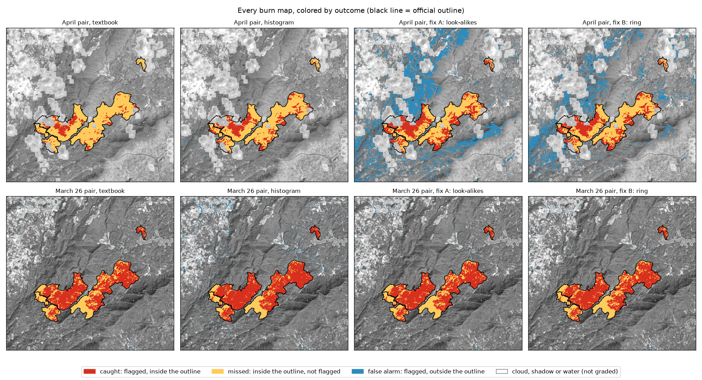

- **Both fixes failed on the April pair.** They catch more of the burn, but about three of every four flags are wrong.
- **The false alarms sit along the mountain ridges.** Likely reason (not proven): higher ground greens up later in spring, so on April 12 the ridges had not leafed out. To a "greened up less than normal" rule, that looks like a burn. I did not load height data to test this.
- **Fix A did not beat fix B.** The before-fire score separates fields from pines, but not a ridge from a valley.
- **On the March 26 pair the fixes change almost nothing,** because unburned land barely moved in 8 days.
- **Timing beat method.** A photo taken days after the fire, before the leaves came out, gave a far better map than any correction applied to a later photo.

Limits of this grading:
- Patches inside a fire outline often did not burn, so 100% caught is not possible.
- The March 26 grade is unfair to that map: the fire grew until about March 31, and ground that burned later counts as "missed".
- The April pair cannot see 11% of the outline (cloud).
- Fix B is not independent of the answer key.

## Next steps
1. Label more spots to narrow the ranges.
2. Try the rule on Cape Fear (Fayetteville), which was 79% clear on the same day.
3. Remove dark plowed fields from the rule, tested on fresh labels.
4. Longer-wave airborne radar (NASA UAVSAR flew the Lumber River on Sept 18-23, 2018) can see water under trees.
5. Burn scars (in progress): test the guess that late green-up on high ground causes the April false alarms (needs height data); try joining the March 26 map with an April map for the part that burned later.

## Project layout
| Path | What it is |
|---|---|
| `src/hls.py` | Shared helpers: login, search, read only the box, cloud mask, water indexes |
| `src/radar.py`, `src/noaa.py`, `src/features.py` | Radar download (HyP3), NOAA airplane photos, per-pixel clues |
| `src/01_find_clear_photos.py` | Step 1: clear photos per river box |
| `src/02_water_maps.py` | Step 2: water indexes and near-infrared flood maps |
| `src/03_radar_flood_map.py` | Step 3: radar flood map and comparison |
| `src/04_make_label_sample.py`, `src/04_label_server.py` | Step 4: random spots and the blind labeling page |
| `src/05_score_maps.py` | Step 5: grading every map against the labels |
| `src/06_machine_learning.py` | Step 6: logistic regression and random forest vs the rule |
| `src/fires.py` | Burn phase: candidate fires, official outlines, study boxes |
| `src/07_find_fire_photos.py` | Step 7: clear photos per fire box; first look at the scar |
| `src/08_burn_maps.py` | Step 8: NBR, dNBR and burn maps from two pairs of photos |
| `src/09_grade_burn_maps.py` | Step 9: grades against the official outline; two leaf-season fixes |
| `notebooks/` | The same steps as notebooks, with explanations |
| `figures/`, `results/` | Saved pictures and result tables (my labels: `results/04_labels.csv`) |
| `LOG.md` | Experiment log: every step, its result, and what I learned |

## Setup
```bash
python3.12 -m venv .venv                      # private package folder for this project
.venv/bin/pip install -r requirements.txt     # exact package versions used
.venv/bin/python src/01_find_clear_photos.py  # Step 1 (about 5 minutes)
.venv/bin/python src/02_water_maps.py         # Step 2 (a minute or two)
.venv/bin/python src/radar.py                 # radar download (15-30 minutes of NASA processing)
.venv/bin/python src/03_radar_flood_map.py    # Step 3
.venv/bin/python src/05_score_maps.py         # Step 5: grades (uses results/04_labels.csv)
.venv/bin/python src/06_machine_learning.py   # Step 6
.venv/bin/python src/07_find_fire_photos.py   # Step 7: burn phase, choose the fire (several minutes)
.venv/bin/python src/08_burn_maps.py          # Step 8: burn maps (a minute or two)
.venv/bin/python src/09_grade_burn_maps.py    # Step 9: grades and fixes (a minute or two)
```
Step 4 (only for new labels): run `src/04_make_label_sample.py` once, then `src/04_label_server.py` and open http://localhost:8765. Steps 5 and 6 use my saved labels in `results/04_labels.csv` when no new labels exist.

Data needs a free NASA Earthdata account (https://urs.earthdata.nasa.gov). Sign in once with `earthaccess.login()`; the login is saved in `~/.netrc`, outside this repo. The radar step also needs a one-time approval of the ASF HyP3 app in your Earthdata profile.

## Data and credits
- **NASA HLS v2.0** (HLSL30, HLSS30), from NASA's LP DAAC.
- **Sentinel-1 radar:** contains modified Copernicus Sentinel data (2018), processed by ESA; terrain-corrected with ASF HyP3 (Alaska Satellite Facility).
- **NOAA National Geodetic Survey** Hurricane Florence emergency response imagery (Sept 19-20, 2018).
- **Fire outlines:** NIFC WFIGS Interagency Fire Perimeters (Black Cove Complex) and USDA Forest Service / USGS Monitoring Trends in Burn Severity (Tellico, Great Lakes).
- No data files are stored in this repo.

## Related
Project 0: [nasa-cmapss-rul](https://github.com/HolySmoresS/nasa-cmapss-rul), predicting jet-engine remaining life.
