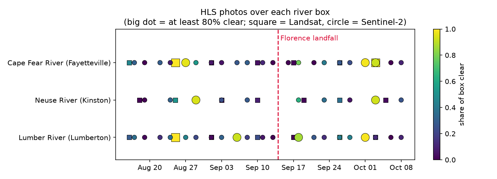

# North Carolina flood mapper (NASA HLS)

**Goal:** map flood water from Hurricane Florence (September 2018) in eastern North Carolina using NASA's Harmonized Landsat Sentinel-2 (HLS) satellite images.

**Status:** Step 1 done: study area chosen (Lumber River at Lumberton). No flood map yet.

## Step 1: finding clear photos
Clouds are the main problem around a hurricane. For three flooded river towns I read the HLS cloud mask (Fmask) for every photo from Aug 15 to Oct 10, 2018, and measured how much of each ~20-30 km box was clear.



| River box | Clear on Sept 18 (4 days after landfall) | Next photo at least 80% clear |
|---|---|---|
| **Lumber (Lumberton)** | **86%** | Sept 18 |
| Cape Fear (Fayetteville) | 79% | Oct 1 |
| Neuse (Kinston) | 63% | Oct 3 |

Only the Lumber River box had a clear photo soon after the storm, plus clear "before" photos (Aug 25, Sept 6), so it is the study area.

**A mistake I caught:** my first count divided by the part of the box a tile covered, not the whole box. A tile touching only 2% of a box scored "97% clear". Fixed by always dividing by the whole box.

Reproduce with `src/01_find_clear_photos.py` (about 5 minutes; needs the Earthdata login).

## Plan
1. Find cloud-free HLS images from before and after the storm.
2. Water index + cutoff (NDWI / MNDWI) as a simple baseline.
3. Flood map = water after the storm that was not water before.
4. Check accuracy against a reference, then try machine learning on labeled pixels and see if it beats the baseline.
5. Later: burn-scar mapping (NBR / dNBR) with the same code.

## Why these choices
- **Florence first:** flat land and very wide floods, which suit 30 m pixels. The known risk is clouds right after the storm.
- **Index before machine learning:** a simple baseline makes it possible to tell whether a fancier model actually helps.
- **`earthaccess`:** searching and reading data in code makes every step repeatable.

## Setup
```bash
python3.12 -m venv .venv                      # private package folder for this project
.venv/bin/pip install -r requirements.txt     # exact package versions used
```
Data needs a free NASA Earthdata account (https://urs.earthdata.nasa.gov). Sign in with `earthaccess.login()`; the login is saved in `~/.netrc`, outside this repo.

## Data
NASA HLS v2.0: HLSL30 (Landsat 8) and HLSS30 (Sentinel-2), from NASA LP DAAC. Not included in this repo.

## Related
Project 0: [nasa-cmapss-rul](https://github.com/HolySmoresS/nasa-cmapss-rul), predicting jet-engine remaining life.
