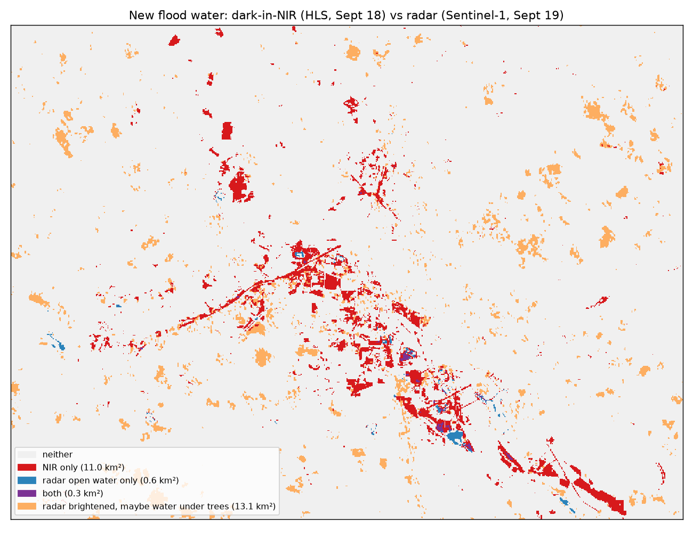
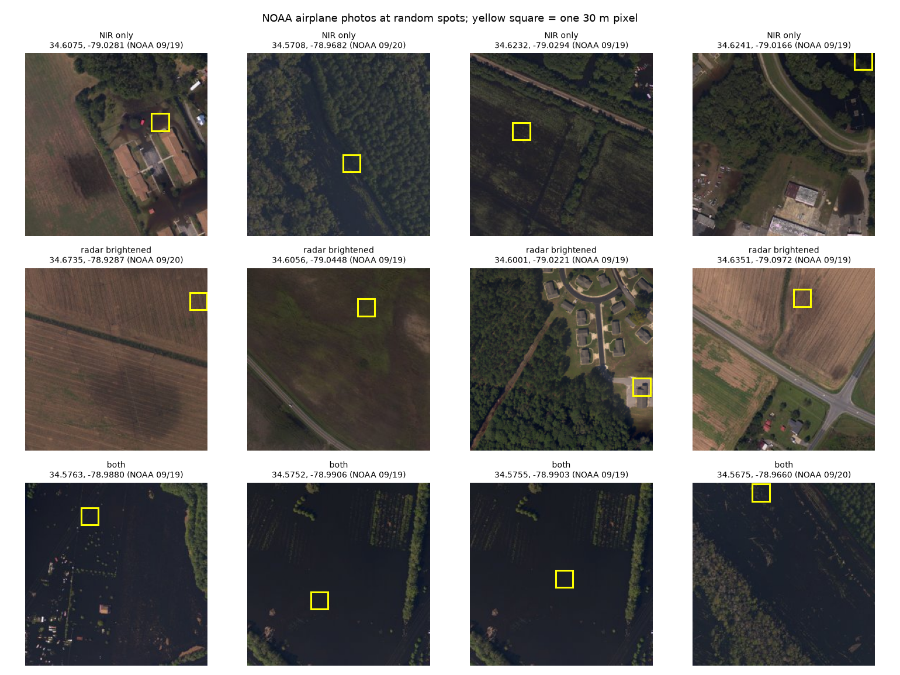

# North Carolina flood mapper (NASA HLS)

**Goal:** map flood water from Hurricane Florence (September 2018) in eastern North Carolina using NASA's Harmonized Landsat Sentinel-2 (HLS) satellite images.

**Status:** Week 3 done: flood maps from near-infrared and radar, graded against 269 hand-labeled spots on NOAA airplane photos.

## Step 1: finding clear photos
Clouds are the main problem around a hurricane. For three flooded river towns I read the HLS cloud mask (Fmask) for every photo from Aug 15 to Oct 10, 2018, and measured how much of each ~20-30 km box was clear.


| River box | Clear on Sept 18 (4 days after landfall) | Next photo at least 80% clear |
|---|---|---|
| **Lumber (Lumberton)** | **86%** | Sept 18 |
| Cape Fear (Fayetteville) | 79% | Oct 1 |
| Neuse (Kinston) | 63% | Oct 3 |

Only the Lumber River box had a clear photo soon after the storm, plus clear "before" photos (Aug 25, Sept 6), so it is the study area.

**A mistake I caught:** my first count divided by the part of the box a tile covered, not the whole box. A tile touching only 2% of a box scored "97% clear". Fixed by always dividing by the whole box.

Reproduce with `src/01_find_clear_photos.py` (about 5 minutes; needs the Earthdata login).

## Plan
1. Find cloud-free HLS images from before and after the storm.
2. A water rule + cutoff as a simple baseline (textbook NDWI / MNDWI first; near-infrared rules after they failed).
3. Flood map = water after the storm that was not water before.
4. Check accuracy against a reference, then try machine learning on labeled pixels and see if it beats the baseline.
5. Later: burn-scar mapping (NBR / dNBR) with the same code.

## Step 2: water maps and first flood maps
Flood = water on Sept 18, 2018 (4 days after landfall) that was not water on Sept 6. Both photos are Sentinel-2.


| Method | New flood water |
|---|---|
| NDWI > 0 (textbook) | 0.2 km² |
| MNDWI > 0 (textbook) | 1.0 km² |
| Dark in near-infrared (NIR < 0.10) | 11.3 km² |
| NIR fell by at least half | 16.5 km² |

**What failed and why:** the textbook water indexes missed most of the flood. The Lumber is a blackwater river, stained tea-brown by leaves. Its water is darker in green light than in shortwave infrared, so the formulas call it land. Every kind of water is very dark in near-infrared, though: in flooded pixels it fell from 0.27 to 0.04.

**Honest limits so far:** the two NIR rules agree on 10.7 km² (63% overlap). The histograms have no clean gap between water and land, so the area depends on the cutoff (5 to 21 km² for dark-in-NIR cutoffs 0.05 to 0.15). Water under thick tree cover may be invisible to any optical satellite. Accuracy has not been checked against a reference yet.

Reproduce with `src/02_water_maps.py` (a minute or two).

## Step 3: our own radar flood map
Radar sends its own microwave pulse, so clouds don't block it. Calm open water reflects the pulse away and looks dark. I used Sentinel-1 radar from Sept 7 (before) and Sept 19 (after), processed by NASA's free HyP3 service.



- Radar found only **0.9 km²** of new open water, against 11.3 km² from near-infrared. The two maps overlap by only about 2-3%.
- **NOAA airplane photos** from Sept 19-20 at 12 random spots: where both agree, it's deep open flood. Where only near-infrared says flood, it's mostly real shallow flood with plants or trees sticking out, which looks rough (land-like) to radar. Where radar got brighter, the photos show dry-looking plowed fields, not water under trees.



**A mistake I caught:** my first radar pair only touched the corner of the box (6% and 0% coverage), so every pixel was blank. The script now checks real coverage before processing.

**Caveats:** 12 spots is a quick look, not a grade. The radar is 1.5 days after the HLS photo, and I used one radar band with one cutoff.

Reproduce with `src/radar.py` (downloads, about 15-30 minutes of NASA processing) and then `src/03_radar_flood_map.py`.

## Step 4: the answer key
To grade the maps fairly, I labeled random spots by eye on NOAA airplane photos from Sept 19-20, 2018: water, not water, or can't tell.
- 269 spots, picked at random from four groups (each map's flood, plus spots every map calls dry), so each map gets tested.
- The labeling page is blind: it never shows which map picked a spot, and the order is shuffled.
- Run it with `.venv/bin/python src/04_make_label_sample.py` (once), then `.venv/bin/python src/04_label_server.py` and open http://localhost:8765.

## Step 5: how good are the maps?


| Map | Caught (share of real flood found) | Right when it says flood | Overall accuracy |
|---|---|---|---|
| Say dry everywhere (baseline) | 0% | - | 96% |
| Dark in near-infrared | 44% (26-82%) | 48% (38-59%) | 96% |
| Near-infrared fell by half | 56% (33-100%) | 42% (33-50%) | 95% |
| Radar, one band, one cutoff | 1% (0-4%) | too few spots | 96% |

Ranges are 95% ranges from re-drawing the labeled spots 2,000 times. Scores are weighted for how many pixels each spot stands for.

- **Overall accuracy is misleading:** most of the box is dry, so a map with no flood at all also scores 96%. That is why I report the other two grades.
- **The near-infrared maps catch about half the flood and are right about half the time.** Misses are mostly water at tree edges and under trees. False alarms include dark plowed fields (bare soil is also dark in near-infrared), roofs and shadows.
- **The simple radar rule caught almost nothing**: it only sees deep, open water.
- **How trustworthy is the answer key?** I re-labeled 40 random spots blind: same answer 65% of the time, 90% when neither pass said "can't tell". My first pass was quick (about 2 seconds a spot) and leaned toward "not water" on unclear spots; using the second-look answers instead moves the grades by only 1-2 points.

Reproduce with `src/05_score_maps.py` (labels are in `results/04_labels.csv`).

## Why these choices
- **Florence first:** flat land and very wide floods, which suit 30 m pixels. The known risk is clouds right after the storm.
- **Index before machine learning:** a simple baseline makes it possible to tell whether a fancier model actually helps.
- **`earthaccess`:** searching and reading data in code makes every step repeatable.

## Setup
```bash
python3.12 -m venv .venv                      # private package folder for this project
.venv/bin/pip install -r requirements.txt     # exact package versions used
```
Data needs a free NASA Earthdata account (https://urs.earthdata.nasa.gov). Sign in with `earthaccess.login()`; the login is saved in `~/.netrc`, outside this repo.

## Data
NASA HLS v2.0: HLSL30 (Landsat 8) and HLSS30 (Sentinel-2), from NASA LP DAAC. Not included in this repo.

## Related
Project 0: [nasa-cmapss-rul](https://github.com/HolySmoresS/nasa-cmapss-rul), predicting jet-engine remaining life.
