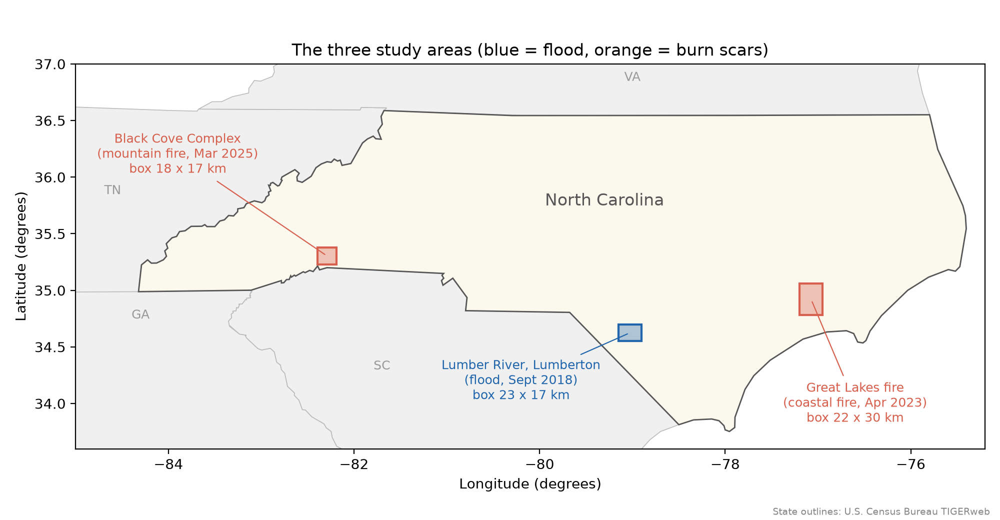

<!-- DRAFT 1 (Nov 15, 2026). Not final until I can explain it back. Every number has its source file in a comment. -->

## 2. Study areas and data

### 2.1 Three study areas
I worked in three boxes in North Carolina (Figure 1). Each box is about 20 to 30 km on a side.

**Figure 1.** The three study areas. Blue: the flood box. Orange: the two fire boxes. State outlines: U.S. Census Bureau.

- **Flood: the Lumber River at Lumberton** (23 x 17 km). Hurricane Florence made landfall on September 14, 2018, and the river flooded the town. The Lumber is a blackwater river: its water is tea-colored from dissolved plant matter.
- **Mountain fire: the Black Cove Complex** (18 x 17 km), Polk County, on the South Carolina border. It started on March 19, 2025, and burned about 31 km².
- **Coastal fire: the Great Lakes fire** (22 x 30 km), Croatan National Forest. It started on April 19, 2023, and burned about 130 km² of flat, swampy ground.

Each fire box is the official fire outline plus a 3 km margin, so it also holds forest that did not burn.

<!-- box sizes: src/12_locator_map.py output. Fire sizes: fires.py (31.1 and 130.1 km2). -->

### 2.2 Satellite data: NASA HLS
My main data is NASA's Harmonized Landsat Sentinel-2 (HLS) surface reflectance, version 2.0. HLS puts Landsat (HLSL30) and Sentinel-2 (HLSS30) on the same 30 m grid, so together they give a picture about every 2 to 3 days. I read only the pixels inside each box, straight from NASA's cloud, with the `earthaccess` Python library.

I used four bands. Their names differ by satellite:

| Light | Sentinel-2 band | Landsat band | Used for |
|---|---|---|---|
| Green | B03 | B03 | Textbook water indexes |
| Near-infrared (NIR) | B8A | B05 | Water rule, burn score |
| Shortwave infrared 1 | B11 | B06 | Textbook water index (MNDWI) |
| Shortwave infrared 2 | B12 | B07 | Burn score (NBR) |

Each HLS picture also has a cloud mask (Fmask). It flags clouds, cloud shadows, snow and water. I treated a pixel as usable only if it was not cloud or shadow.

### 2.3 Choosing the photos
Clouds were the main risk, especially right after a hurricane. For every candidate photo I measured the **clear share of the whole box**, not just of the part the photo covered. (My first count made that mistake: a photo touching 2% of a box scored "97% clear".) I kept photos at least 80% clear.

Before and after each event, I used two photos from the same satellite, so any change comes from the ground and not from a camera change.

| Study area | Before | After | Clear share (before / after) |
|---|---|---|---|
| Lumber River | Sentinel-2, Sept 6, 2018 | Sentinel-2, Sept 18, 2018 | 92% / 86% |
| Black Cove, March pair | Landsat, Mar 18, 2025 | Landsat, Mar 26, 2025 | 100% / 100% |
| Black Cove, April pair | Sentinel-2, Mar 11, 2025 | Sentinel-2, Apr 12, 2025 | 100% / 80% |
| Great Lakes, Landsat pair | Landsat, Apr 18, 2023 | Landsat, May 4, 2023 | usable on both: 92% |
| Great Lakes, Sentinel-2 pair | Sentinel-2, Apr 10, 2023 | Sentinel-2, May 10, 2023 | usable on both: 91% |

<!-- Lumber: results/01_clear_photos.csv. Black Cove: results/07_fire_photos.csv. Great Lakes: results/11_great_lakes_pair_facts.csv ("box usable"). -->

- **Lumberton** was the only one of three flooded river towns with a clear photo soon after the storm: four days after landfall. The next clear photo came 17 days after landfall at Fayetteville and 19 days at Kinston.
- **Black Cove** had a perfectly clear photo one day before the fire. The March 26 photo was taken while the fire was still growing (it grew until about March 31). The April 12 photo came after the fire stopped, but by then the spring leaves were coming out.

<!-- results/01_summary.csv (4, 17, 19 days). -->

### 2.4 Other data
- **NOAA airplane photos** (National Geodetic Survey, Sept 19-20, 2018). These are sharp aerial photos taken one day after the flood photo. I used them to build the flood answer key (Section 3).
- **Sentinel-1 radar** (Sept 7 and Sept 19, 2018), terrain-corrected with NASA's free HyP3 service (Alaska Satellite Facility). Radar sees through clouds. I used it as a second flood map.
- **Official fire outlines** from the National Interagency Fire Center (NIFC). The Great Lakes outline is the agencies' certified final outline. The Black Cove outline is marked "auto-generated", not certified.
- **Ground height** from NASADEM (NASA JPL), 30 m. I used it to test why one fix failed in the mountains.

---

### Notes for me (delete before final)
**Explain back, out loud:**
1. What does HLS join together, and why does that help after a hurricane?
2. Why measure the clear share over the whole box?
3. Why must the before and after photos come from the same satellite?

